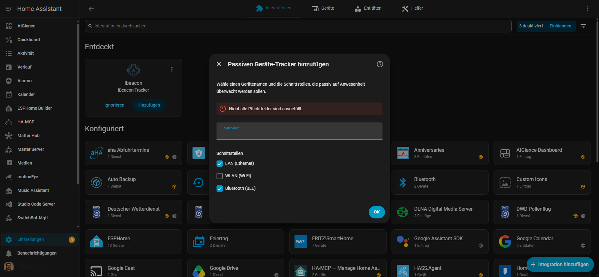

# Passive Device Tracker (LAN / WLAN / Bluetooth LE)

  

A lightweight, high-performance, and privacy-respecting Home Assistant device integration for multi-interface presence tracking. Developed in collaboration with **Omni Consumer Products (OCP)**.

---

## 📸 Screenshots

  

  <em>Configuration dialog: easily register devices with multi-interface tracking across LAN, Wi-Fi roaming, and passive Bluetooth LE advertisement listeners.</em>

---

## ✨ Key Advantages & Features

- **Multi-Interface Device Tracking**:
  - **LAN (Ethernet)**: Track devices via static IP or dynamic MAC address.
  - **WLAN (Wi-Fi)**: Track mobile devices or laptops that roam between Wi-Fi and wired Ethernet without duplicate tracker entities.
  - **Bluetooth LE**: Passive Bluetooth advertisement listener using Home Assistant's native Bluetooth proxy/adapter framework. Zero battery drain on client devices and no active pairing required.
- **Dynamic DHCP Resolution via ARP**:
  - When tracking by MAC address, the current IPv4 address is continuously and automatically resolved from the local system ARP cache (`/proc/net/arp`, `ip neigh`, or Windows ARP). If your router assigns a new dynamic IP, the tracker adapts seamlessly without configuration updates.
- **Multi-Interface Roaming & Debouncing**:
  - A device is considered `home` (`connected`) as long as **any** of its configured interfaces reports recent activity.
  - Roaming between interfaces is smooth and instant.
  - The device only transitions to `not_home` after **all** configured interfaces remain silent for longer than the configurable `consider_home` timeout (default: 180 seconds).
- **Intelligent Capability Check**:
  - Bluetooth tracking is only offered in the configuration flow if Home Assistant actually possesses registered Bluetooth scanners or proxies (`bluetooth.async_scanner_count > 0`). If no Bluetooth hardware exists, Bluetooth options are automatically omitted.
- **Standard Home Assistant Device Integration**:
  - Integrated directly via **Settings > Devices & Services > Add Integration** (not an artificial helper), properly registered with manufacturer `"Omni Consumer Products"`.
- **Trilingual**:
  - Full native localization for **English (`en`)**, **German (`de`)**, and **Indonesian (`id`)**.

---

## 🚀 Installation

### Via HACS (Recommended)

1. Click the HACS 1-click badge above, or open **HACS > Integrations > Top-right menu > Custom repositories**.
2. Add repository URL: `https://github.com/adromir/ha-passive-device-tracker` with category **Integration**.
3. Click **Download** and choose the latest release.
4. Restart Home Assistant.

### Manual Installation

1. Copy the `custom_components/passive_device_tracker` directory to your Home Assistant `config/custom_components/` folder.
2. Restart Home Assistant.

---

## ⚙️ Configuration

1. In Home Assistant, navigate to **Settings > Devices & Services > Integrations**.
2. Click **Add Integration** and search for **Passive Device Tracker**.
3. Enter your device name (e.g. `Adromir Laptop`, `Pixel Phone`) and select the interfaces you want to monitor:
   - `LAN (Ethernet)`
   - `WLAN (Wi-Fi)`
   - `Bluetooth (BLE)` *(only shown if Bluetooth hardware is detected)*
4. Fill in the network identifiers:
   - **LAN**: IPv4 address and/or Ethernet MAC address.
   - **WLAN**: IPv4 address and/or Wi-Fi MAC address.
   - **Bluetooth**: Bluetooth LE MAC address (`XX:XX:XX:XX:XX:XX`).
5. Set optional timing parameters:
   - **Consider Home**: Grace period before marking the device away (default: 180 seconds).
   - **Ping Interval**: Background network probe interval (default: 30 seconds).

### Reconfiguring & Options

You can adjust the `consider_home` duration, `ping_interval`, and interface parameters at any time by clicking **Configure** on the integration card.

---

## 🔍 Diagnostic Attributes

The tracker entity exposes comprehensive diagnostic state attributes:

| Attribute | Description |
| :--- | :--- |
| `active_interface` | The primary interface that most recently verified presence (`lan`, `wlan`, `bluetooth`) |
| `last_seen` | ISO 8601 timestamp of the most recent interface detection |
| `active_interfaces` | List of all configured interfaces |
| `lan_ip` / `lan_mac` | Configured / resolved LAN coordinates |
| `wlan_ip` / `wlan_mac` | Configured / resolved WLAN coordinates |
| `bluetooth_mac` | Configured Bluetooth address |
| `consider_home` | Configured grace timeout in seconds |

---

## 🛡️ Disclaimer

This software is provided "as is", without warranty of any kind. Omni Consumer Products (OCP) assumes no liability for unauthorized rogue devices escaping local tracker boundaries.

---

## 📄 License

Distributed under the **MIT License**. See [LICENSE](LICENSE) for more information.

---

## 👤 Author

Developed by **Adromir**  
GitHub: [https://github.com/adromir](https://github.com/adromir)  
Support: [Ko-Fi](https://ko-fi.com/adromir)
